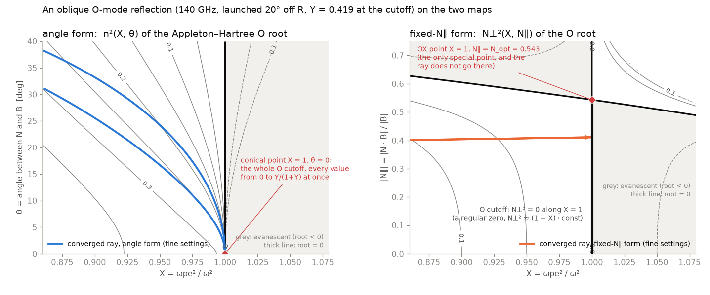

# Ray Tracing

## Ray Tracing Equations

As introduced in [Theory](../theory.md), the local wave vector $\boldsymbol{k}$ satisfies the dispersion relation $\det \boldsymbol{\mathsf{D}} = 0$.

For ray tracing, we define a Hamiltonian $\mathcal H(\boldsymbol{r}, \boldsymbol{k})$ as the real part of the dispersion relation determinant (or a scalar function proportional to it), assuming that the anti-Hermitian part of the dielectric tensor (representing absorption) is small (weak damping approximation):

$$ \mathcal H(\boldsymbol{r}, \boldsymbol{k}) = \text{Re}(\det \boldsymbol{\mathsf{D}}) = 0 $$

The ray equations can then be derived from Hamilton's equations in terms of a time-like parameter $t$ along the ray, the *Hamiltonian time*:

$$\frac{d\boldsymbol{r}}{dt} = \frac{\partial \mathcal H}{\partial \boldsymbol{k}}, \quad \frac{d\boldsymbol{k}}{dt} = -\frac{\partial \mathcal H}{\partial \boldsymbol{r}}$$

or, with the refractive index vector $\boldsymbol{n}=\boldsymbol{k}c/\omega$,

$$\frac{d\boldsymbol{r}}{dt} = \frac{\partial \mathcal H}{\partial \boldsymbol{n}}, \quad \frac{d\boldsymbol{n}}{dt} = -\frac{\partial \mathcal H}{\partial \boldsymbol{r}}.$$

Raytrax integrates these equations in $t$. The arc length $s$ along the ray is carried along as a further state variable,

$$\frac{ds}{dt} = \left|\frac{\partial \mathcal H}{\partial \boldsymbol{n}}\right|,$$

together with the optical depth, $d\tau/dt = \alpha\,ds/dt$ (see [absorption](absorption.md#optical-depth)). The arc length remains the coordinate of all output profiles and of `TracerSettings.max_arc_length`, but it is left out of the error norm of the step-size controller: it is an output, and its error does not feed back into the ray.

The equations are deliberately not divided by $|\partial \mathcal H/\partial \boldsymbol{n}|$ to integrate in $s$ directly, because this quantity vanishes where a ray is reflected. At the O-mode cutoff $X = 1$ the Stix parameter $P$ vanishes and $\mathcal H$ carries a factor $n_\perp^2$ (see [below](#cold-tracing)), so the group velocity $\partial \mathcal H/\partial \boldsymbol{n}$ is zero on the whole cutoff, at oblique incidence too: the ray comes to rest and turns back like a ball thrown upwards. In the arc length the right-hand side is $0/0$ there, the unit tangent flips by 180° and the path has a cusp. In Hamiltonian time the reflection is a regular point of the flow, with $n_\perp \propto -t$ and the distance to the cutoff $\propto t^2$.

The gradients $\partial \mathcal H/\partial \boldsymbol{r}$ and $\partial \mathcal H/\partial \boldsymbol{n}$ are computed in Raytrax using automatic differentiation in the function `hamiltonian_value_and_gradients`, starting from a scalar Hamiltonian function.

## Plasma Boundary

If the electron density does not vanish at the plasma boundary, the ray has to be refracted at the plasma–vacuum interface. Raytrax extends the profile with a ramp to zero over $\Delta\rho = 0.02$. A shape-preserving cubic interpolant joins profile and ramp with a continuous gradient.

A Runge-Kutta step can skip this thin ramp and miss the refraction. The controller therefore also measures the change $\Delta \mathcal H$ of the conserved Hamiltonian over each step, expressed as the relative frequency mismatch it amounts to,

$$\frac{\delta\omega}{\omega} = \frac{\Delta \mathcal H}{\omega\,\partial \mathcal H/\partial\omega\,|_{\boldsymbol{k}}}, \qquad \omega\,\frac{\partial \mathcal H}{\partial\omega}\Big|_{\boldsymbol{k}} = \omega\,\frac{\partial \mathcal H}{\partial\omega}\Big|_{\boldsymbol{n}} - \boldsymbol{n}\cdot\frac{\partial \mathcal H}{\partial \boldsymbol{n}},$$

the relative change of frequency that would put the wave back on the dispersion surface. To first order it is the same for $\mathcal H$ and for $f\,\mathcal H$ with any smooth non-zero $f$, so it measures the ray and not the form of $\mathcal H$, and it stays finite at a reflection, where $\partial \mathcal H/\partial \boldsymbol{n}$ vanishes but $\partial \mathcal H/\partial\omega$ does not. The controller adds $w\,|\delta\omega/\omega|$ to its error estimate, with `TracerSettings.dispersion_error_weight` setting $w$ (default 30); $\partial \mathcal H/\partial\omega$ comes out of the same reverse-mode pass as $\partial \mathcal H/\partial \boldsymbol{n}$. This detects missed refraction without modifying Hamilton's equations. Invariants such as $R\,n_\varphi$ in an axisymmetric configuration are preserved to the accuracy of the integration.

## Cold Tracing

The easiest situation is that of a "cold" plasma, where relativistic effects can be neglected. We start with the fluid momentum equation, which represents the first moment of the Boltzmann equation for electrons (all other species are treated as static):

$$\frac{\partial \boldsymbol{v}_e}{\partial t} + (\boldsymbol{v}_e \cdot \nabla) \boldsymbol{v}_e = -\frac{e}{m_e} \left[ \boldsymbol{E} + \boldsymbol{v}_e \times \boldsymbol{B} \right] - \frac{\nabla P_e}{m_e n_e} + \boldsymbol{C}_e$$

Considering perturbations of these quantities in a background magnetic field $\boldsymbol{B}_0$ assuming plane wave solutions $\sim \exp(i(\boldsymbol{k}\cdot\boldsymbol{r} - \omega t))$,

- $\boldsymbol{v}_e = \boldsymbol{v}_{0e} + \tilde{\boldsymbol{v}}_e$
- $\boldsymbol{B} = \boldsymbol{B}_0 + \tilde{\boldsymbol{B}}$
- $\boldsymbol{E} = \mathbf{0} + \tilde{\boldsymbol{E}}$

neglecting background flow ($\boldsymbol{v}_{0e} = \mathbf{0}$), dropping second-order terms, and neglecting $\nabla P_e$ and $\boldsymbol{C}_e$ (cold, collisionless plasma), one arrives at

$$-i\omega m_e \tilde{\boldsymbol{v}}_e = -e (\tilde{\boldsymbol{E}} + \tilde{\boldsymbol{v}}_e \times \boldsymbol{B}_0)$$

Solving this for the electron velocity perturbation $\tilde{\boldsymbol{v}}_e$ allows us to calculate the induced current density $\boldsymbol{j} = -e n_{e0} \tilde{\boldsymbol{v}}_e$, where $e > 0$ is the elementary charge. By relating $\boldsymbol{j}$ to the electric field through $\boldsymbol{j} = \boldsymbol{\sigma} \cdot \tilde{\boldsymbol{E}}$ and using the relation $\boldsymbol{\varepsilon} = \boldsymbol{I} + \frac{i\boldsymbol{\sigma}}{\omega \epsilon_0}$, we obtain the cold plasma dielectric tensor. 

In a local coordinate system where $\boldsymbol{B}_0$ is aligned with the $z$-axis, the dielectric tensor takes the following simplified form using the Stix notation:

$$\boldsymbol{\varepsilon} = \begin{pmatrix} S & -iD & 0 \\ iD & S & 0 \\ 0 & 0 & P \end{pmatrix}$$

Here, the Stix parameters $S$, $D$, and $P$ are defined in terms of the standard dimensionless parameters $X = \omega_p^2/\omega^2$ and $Y = \omega_c/\omega$ (with $\omega_p = \sqrt{e^2 n_e/(\epsilon_0 m_e)}$ the electron plasma frequency and $\omega_c = eB_0/m_e$ the electron cyclotron frequency):

- $S = 1 - \frac{X}{1-Y^2}$
- $D = \frac{XY}{1-Y^2}$
- $P = 1 - X$

Returning to the dispersion tensor $\boldsymbol{\mathsf{D}} = \boldsymbol{\varepsilon} - n^2 \boldsymbol{I} + \boldsymbol{n}\boldsymbol{n}$, we assume the wave vector $\boldsymbol{n}$ lies in the $x$-$z$ plane at an angle $\theta$ to the background magnetic field, such that $\boldsymbol{n} = (n \sin \theta, 0, n \cos \theta)$.

Substituting $\boldsymbol{\varepsilon}$ into $\boldsymbol{\mathsf{D}}$ and enforcing the non-trivial solution condition $\det \boldsymbol{\mathsf{D}} = 0$ yields a quadratic equation in $n^2$. Solving it gives the Appleton-Hartree dispersion relation, which expresses the refractive index as a function of the propagation angle $\theta$ and plasma parameters:

$$n_{AH}^2 = 1 - \frac{X}{1 - \frac{Y^2 \sin^2 \theta}{2(1-X)} \pm \sqrt{\left(\frac{Y^2 \sin^2 \theta}{2(1-X)}\right)^2 + Y^2 \cos^2 \theta}}$$

The $\pm$ sign selects the two characteristic wave modes of the magnetized plasma: the Ordinary (O) wave ($+$) and the Extraordinary (X) wave ($-$).

Raytrax does not use this angle form as its Hamiltonian. In the variables $(X, \theta)$ the whole O-mode cutoff is a single point: on the segment

$$X = 1, \qquad n_\perp = 0, \qquad n_\parallel^2 < \frac{Y}{1+Y}$$

the dispersion relation holds for every $n_\parallel$ (at $X = 1$ the Stix parameter $P$ vanishes and $\det \boldsymbol{\mathsf{D}}$ acquires a factor $n_\perp^2$: the plasma oscillation $\omega = \omega_p$), and $\theta = \arctan(n_\perp/n_\parallel) = 0$ on all of it. The radicand of the Appleton-Hartree formula vanishes exactly at $X = 1$, $\theta = 0$, so the square root is a cone there and the derivatives of $n_{AH}^2$ have no limit. Every oblique O-mode reflection passes through this point, where the stages of a Runge-Kutta step evaluate $\mathcal H$ on different sheets of the cone and the error estimate of the step is meaningless.

Instead, the dispersion relation is solved for the perpendicular refractive index at the ray's own $n_\parallel^2 = (\boldsymbol{n} \cdot \boldsymbol{b})^2$, with $\boldsymbol{b} = \boldsymbol{B}_0/|\boldsymbol{B}_0|$. With the Stix parameters multiplied by $1-Y$, $1+Y$ and $1-Y^2$, which removes their poles at $Y = 1$,

$$\tilde R = 1 - Y - X, \qquad \tilde L = 1 + Y - X, \qquad \tilde S = 1 - Y^2 - X, \qquad P = 1 - X,$$

$\det \boldsymbol{\mathsf{D}} = 0$ is a quadratic in $N_\perp^2$,

$$\tilde S\,N_\perp^4 + b\,N_\perp^2 + c = 0, \qquad b = \big(\tilde S + (1-Y^2)P\big)\,n_\parallel^2 - \tilde R \tilde L - P \tilde S, \qquad c = P\,\big((1-Y)\,n_\parallel^2 - \tilde R\big)\big((1+Y)\,n_\parallel^2 - \tilde L\big),$$

whose discriminant factorises as $b^2 - 4\tilde S c = X^2 Y^2 \big[Y^2 (1-n_\parallel^2)^2 + 4 n_\parallel^2 (1-X)\big]$. Its roots are

$$N_\perp^2(n_\parallel^2, X, Y) = \frac{-b \pm X Y \sqrt{Y^2 (1-n_\parallel^2)^2 + 4 n_\parallel^2 (1-X)}}{2 \tilde S},$$

with $+$ the O mode and $-$ the X mode for every $Y$ (`refractive_index_perp_squared_cold`). The discriminant is evaluated in its factorised form, which keeps its digits at low density, and it is positive for every $X \le 1$: the root has no branch point anywhere below the cutoff. It depends on $n_\parallel$ only through $n_\parallel^2$, so parallel propagation needs no special treatment. The cold plasma Hamiltonian is then

$$ \mathcal{H}(\boldsymbol{r}, \boldsymbol{n}) = n_\perp^2 - N_\perp^2\big(n_\parallel^2, X(\boldsymbol{r}), Y(\boldsymbol{r})\big), \qquad n_\perp^2 = \boldsymbol{n}\cdot\boldsymbol{n} - n_\parallel^2, $$

so that $\mathcal{H} = 0$ is equivalent to the dispersion relation of the selected mode, which the user specifies as O or X. Next to the O-mode cutoff the root is

$$N_\perp^2 \simeq \kappa\,(1 - X), \qquad \kappa = \frac{\big((1-Y)\,n_\parallel^2 + Y\big)\big(Y - (1+Y)\,n_\parallel^2\big)}{Y^2\,(1 - n_\parallel^2)} > 0 \quad \text{for } n_\parallel^2 < \frac{Y}{1+Y},$$

a regular zero: the ray turns there, and its group velocity vanishes as it does. $\kappa$ vanishes at $n_\parallel^2 = Y/(1+Y)$, the O-X point where the two roots touch; see [limitations](../limitations.md#ray-tracing).

*An oblique O-mode reflection (140 GHz, launched 20° off the major radius in an analytic tokamak) on the two maps, both at the $Y$ of the turning point. Left: the Appleton-Hartree root over $(X, \theta)$; every contour between 0 and $Y/(1+Y)$ ends at the conical point $X = 1$, $\theta = 0$, which the ray has to run into to turn around. Right: the fixed-$n_\parallel$ root over $(X, n_\parallel)$; the contours are a regular family, the zero line is $X = 1$ up to the O-X point, and the ray turns at a regular point of it.*

!!! info

    Currently, only the cold plasma Hamiltonian is used for tracing in Raytrax. The [absorption coefficient](absorption.md) is calculated fully relativistically.
